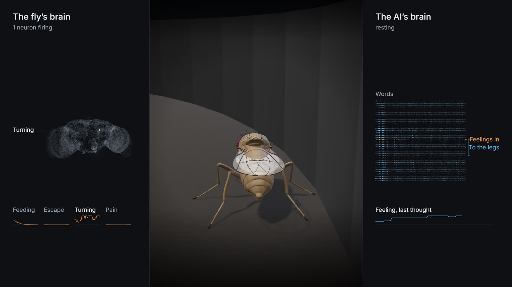
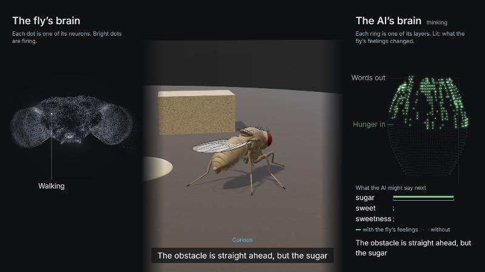

# flysim

flysim is a fruit fly you can watch, poke and talk to. Its brain is the real FlyWire wiring diagram of an adult *Drosophila* brain: 138,639 neurons and 15.1 million connections, simulated spike by spike on the GPU. That brain drives a physics model of the fly's body in a small arena. A local language model (Qwen3-4B) writes the fly's thoughts in the first person, and the body's state is added to that model's activations while it writes: pain, danger, hunger, thirst, heat, cold and arousal. The fly gets hungry and thirsty, feels heat and cold, can be given drugs, and can die.

Everything runs on your own Windows PC. No account or API key is needed.





## What runs

| Part | What it is | Where |
|---|---|---|
| Brain | A leaky integrate-and-fire model of all 138,639 neurons of the FlyWire v783 connectome, with the equations and constants of Shiu et al. 2024 (*Nature*). 0.1 ms steps, run in 10 ms windows. NVIDIA Warp CUDA kernels on the GPU; numba on the CPU when there is no GPU. | `flysim/brain.py`, `flysim/brain_warp.py` |
| Body | The flygym 2.1 FlyBody model in MuJoCo: 42 leg joints, contacts, gravity, a CPG walking controller. Descending-neuron spike rates set its forward speed and turning. Giant-fibre spikes trigger take-off. | `flysim/body.py`, `flysim/bridge.py` |
| Senses | Looming objects drive LPLC2 and LC4, sugar and bitter drive the taste neurons, touch drives the antennal mechanoreceptors, heat and cold drive the thermosensors. Every input enters through the brain. | `flysim/autonomy.py`, `flysim/world.py` |
| Body economy | Energy and water reserves (time-compressed: minutes, not days), body temperature with heat stupor at 41 C and chill coma at 7 C, and health. The fly dies of starvation, thirst, heat, cold, fire or being crushed. | `flysim/physiology.py` |
| Drugs | Ethanol, nicotine, caffeine, cocaine, picrotoxin, isoflurane, octopamine and gaboxadol. Each one changes synaptic weights or resting potentials in the brain by transmitter class (ethanol, for example, strengthens GABA synapses and weakens ACh synapses), plus scripted body effects such as ataxia and knockdown. Injected, fed or breathed. | `flysim/pharma.py` |
| Mind | Qwen3-4B (Q4_K_M) in llama.cpp. It writes a short first-person thought when something happens, and picks what the body does next. Each drive level becomes a dose of a steering vector added to the residual stream at layer 18, re-set while the thought is being written. `set FLYSIM_READOUT=on` also turns on the reverse path: a read-out of layers 11 to 18 (freeze, avoid, approach) biases the descending neurons. | `pain_server/` (port 8095) |
| Voice (optional) | Kokoro-82M speaks the thoughts on the CPU, with delivery set by pain, sedation and dying. Whisper small.en turns your speech into text when you hold the backquote key. | `voice/` (port 8097) |
| Front end | A three.js page: the 3D world, the brain with every spike lit, the language model's activity, and the side panel. | `web/`, served on http://127.0.0.1:8765 |

## Requirements

| | Minimum | Measured on the development machine |
|---|---|---|
| OS | Windows 10 or 11, 64-bit | Windows 11 Pro |
| GPU | NVIDIA GPU with 6 GB VRAM. Driver 580 or newer for the CUDA 13 build of llama.cpp (Turing or newer), 551.61 or newer for the CUDA 12 build. Without an NVIDIA GPU everything runs on the CPU, slowly. | RTX 5060 Ti 16 GB, driver 616.56. Mind server about 3.5 GB VRAM, brain about 1 GB. |
| RAM | 16 GB | Simulator about 2.4 GB peak while it loads the connectome. Mind server 3.1 GB. Voice server 1.8 GB. |
| CPU | 4 cores | i7-9700KF, 8 cores |
| Disk | 7 GB free (9 GB with the voice) | Model 2.5 GB, simulator environment about 1.3 GB, llama.cpp CUDA 13 about 0.7 GB, connectome 135 MB, FlyBody meshes 134 MB |
| Software | Python 3.12 (64-bit). curl, which Windows 10 and 11 include. A browser with WebGL 2 (Edge, Chrome or Firefox). | Python 3.12.10 |
| Network | Needed for the install and for the page's fonts. The simulation runs offline. | |

## Install

1. Install Python 3.12 (64-bit) if you do not have it: `winget install -e --id Python.Python.3.12`, or the "Windows installer (64-bit)" from https://www.python.org/downloads/windows/.
2. Download or clone this repository to a folder on a drive with 7 GB free.
3. Double-click `install.bat`. For the voice, run `install.bat --voice` from a command prompt in that folder.

`install.bat` does this, and skips any step that is already done:

1. Finds Python 3.12 (`FLYSIM_PYTHON`, then `py -3.12`, then `python`).
2. Checks the free disk space.
3. Reads the GPU and driver with `nvidia-smi` and picks the llama.cpp build: `cuda13`, `cuda12` or `cpu`. `--cuda13`, `--cuda12` and `--cpu` override the choice.
4. Creates `.venv` and installs the simulator's packages from `requirements\app.txt`, pinned by `requirements\app-constraints.txt`. Fetches the FlyBody meshes flygym uses.
5. Creates `.venv_mind` and installs `requirements\mind.txt` (numpy and aiohttp; the model runs in llama.dll).
6. Downloads and checks (size and SHA-256) these files:

   | File | From | Size |
   |---|---|---|
   | `models\Qwen3-4B-Q4_K_M.gguf` | huggingface.co/bartowski/Qwen_Qwen3-4B-GGUF, file `Qwen_Qwen3-4B-Q4_K_M.gguf` | 2.50 GB |
   | `llama\` | github.com/ggml-org/llama.cpp release b10435: `llama-b10435-bin-win-cuda-13.3-x64.zip` and `cudart-llama-bin-win-cuda-13.3-x64.zip` (or the 12.4 or CPU build) | 147 MB + 391 MB (CUDA 13) |
   | `third_party\Drosophila_brain_model\Connectivity_783.parquet`, `Completeness_783.csv` | github.com/philshiu/Drosophila_brain_model | 101 MB + 3 MB |
   | `data\flywire\Supplemental_file1_neuron_annotations.tsv` | github.com/flyconnectome/flywire_annotations | 32 MB |

7. With `--voice`: creates `.venv_voice`, installs PyTorch 2.11.0 (CPU build) and `requirements\voice.txt`, and puts Kokoro-82M (327 MB) and Whisper small.en (484 MB) into the Hugging Face cache.

`install.bat --dry-run` checks Python, the disk, the GPU and every download URL, and installs nothing. An interrupted download resumes when you run `install.bat` again. The steering vectors in `pain_server\vectors\` were made on that exact GGUF file, so the installer pins it by hash.

## Run

Double-click `run.bat`. It:

1. starts the mind server on port 8095 and waits until it answers (the first load takes a minute or two),
2. starts the voice server on port 8097 if you installed it,
3. starts the simulator, which builds the body and the brain (15 to 60 seconds) and opens http://127.0.0.1:8765 in an Edge app window, or in your default browser if Edge is missing.

The servers run in the same console window and write to `logs\`. Close that window, or press Ctrl+C in it, to stop everything.

| Command | What it does |
|---|---|
| `run.bat` | brain and mind on the GPU; both on the CPU when `nvidia-smi` finds no NVIDIA GPU |
| `run.bat --cpu` | brain (numba) and mind on the CPU |
| `run.bat --openrouter` | the mind is an online model through OpenRouter instead of the local Qwen3-4B (see below) |
| `run.bat --no-voice` | does not start the voice server |
| `run.bat --world labyrinth` | any other argument goes to the simulator (`--world`, `--seed`, `--port`, `--no-browser`, `--memory off`) |

Settings, set in the console before `run.bat` (`set NAME=value`) or once for your account (`setx NAME value`):

| Variable | Default | Effect |
|---|---|---|
| `FLYSIM_GPU` | `cuda:0` | the card for the brain and the mind |
| `FLYSIM_BACKEND` | `warp` with a GPU, `numba` without | `numba` runs the brain on the CPU and leaves the GPU to the mind |
| `FLYSIM_MIND_DEVICE` | the same as `FLYSIM_GPU` | `cpu` runs the mind on the CPU and leaves the GPU to the brain |
| `FLYSIM_MIND_PORT` | `8095` | the mind server's port |
| `PAIN_THREADS` | `4` | CPU threads for the mind |
| `OPENROUTER_API_KEY` | none | the key for `--openrouter` |
| `FLYSIM_L2_MODEL` | `google/gemini-3.5-flash-lite` | the OpenRouter model id for `--openrouter` |

### The online mind (OpenRouter)

`run.bat --openrouter` sends the mind's prompts to openrouter.ai instead of the local model. The app reads the key from the `OPENROUTER_API_KEY` environment variable (or `FLYSIM_L2_KEY`) and from nowhere else; nothing in this repository stores a key. An online model cannot be steered, so it gets the fly's drives as text. OpenRouter charges per token; the app pauses the online mind while no browser page is connected. The local mind needs no key and has no cost.

## First minute

1. Wait for the page to finish loading. The fly starts in the Classic arena: four props, a drop of sugar and a drop of water.
2. Click **Demo** in the top bar. It loads the Showcase world, wakes the mind, turns on the auto-director and switches to the cinematic stage. Esc leaves the stage.
3. Or click **Wake the mind** in the Mind tab. The fly now thinks when something happens; its thoughts appear in the journal and as a subtitle.
4. Press Enter, type a sentence and press Enter again. The fly hears it as a humming in its antennae and may answer.
5. Press 5 and click near the fly to place a fire. Or open Tools in the palette, pick Swat and click near the fly: a hand comes down and the fly sees it loom.

## Controls

The page lists these too: press `?` or `H`.

| Group | Keys |
|---|---|
| Camera | `W` `A` `S` `D` or arrows move · `Q` `E` orbit · `Z` `X` or the wheel zoom · `Shift` faster · `F` follow the fly · `C` centre on it |
| Time | `Space` pause · `.` step · `-` `=` slower / faster (¼, ½, 1×, 2×, max) |
| Edit | click a thing to select it, drag to move it, drag the fly to pick it up · `1` select, `2` sugar, `3` water, `4` bitter, `5` fire, `6` ice, `7` block, `8` wall, `9` rock, `0` stem, `J` laced food, `N` brain fly · `R` turn (`Shift+R` the other way) · `[` `]` size · `Del` or right-click removes · `Ctrl+Z` undo, `Ctrl+Y` redo · `\` collapses the tool palette |
| Views | `Enter` or `T` talk to the fly · `Tab` in the talk box switches say / order · `O` worlds · `V` fields (warmth, cold, humidity) · `G` memory ghosts · `B` swap the world and the brain · `P` brain inset · `M` side panel · `I` larger interface · `Shift+M` clean view · `Shift+P` presentation (big text, 16:9) |
| Tabs | `K` Signals · `U` Drugs · `Y` Memory · `L` Lab · `Esc` back to Mind |
| Cinema | `Shift+C` cinematic camera on or off; then `Shift+V` next camera, `Shift+G` next layout, `Shift+H` swap sides, `Shift+L` letterbox or 16:9, `Shift+D` depth of field, `Shift+J` drive strip, `Shift+R` record · `Shift+N` docks the brain column beside the world |
| Voice | hold `` ` `` (backquote) to talk, release to send; works when Voice is on and the cursor is not in a text box |

Mouse: in the world, drag to orbit, scroll to zoom, double-click the floor to drop an object. In the brain view, drag to orbit, scroll to zoom, right-drag to pan. The brain is seen from the front, so the fly's left is on the right of the screen.

### Tool palette

The labelled rail at the left of the world view holds the tools. Select: pick up, drag, turn and resize things. Food: sugar, water, bitter. Objects: block, wall (drag to draw), rock, stem, twig. Flies: set the fly down (press where it lands, release where it faces), brain fly (another fly with its own copy of the brain and no mind). Hazards: fire, ice. Drugs: dose the fly, or lace food with the chosen drug. Tools: puff (a gust of air from where you click), swat (a hand comes down; Shift+click swats fast), remove.

### The side panel

| Tab | What it shows |
|---|---|
| Mind | the drive bars, the journal of thoughts with what each one led to, the talk box (say: the mind hears it and may answer; order: drives the motor layer for 40 s), Wake the mind, and the voice buttons |
| Signals | every drive the body sends into the language model at layer 18 (pain, danger, hunger, thirst, heat, cold, arousal): the level now and the dose added; and the pain circuit |
| Drugs | one card per drug: what it does, a dose, inject, feed or vapour, and what is in the fly now |
| Memory | what the fly believes about its world, past episodes, and how memory bids for the body |
| Lab | performance, the what-drives-what chain, descending-neuron rates, activate or silence any cell type or FlyWire root ID, stimuli, the raw sensory state and the event log |
| Settings | the mind's model, what the fly lives for, who controls the fly, how much the body throttles the mind, and the voice engine |

Worlds (`O`): Classic, Labyrinth, Two rooms, Oasis, Winter, Bitter garden, Forest, Ring of fire, Empty, Stage and Showcase. Loading a world rebuilds the arena, puts the fly at its start and wipes its memory; undo brings the old one back. Saved worlds go to `worlds\`.

## Troubleshooting

| Problem | Cause and fix |
|---|---|
| A Python command, `install.bat` or `run.bat` hangs with no output | On some machines the Windows WMI service hangs, and Python 3.12's `platform` module waits on it during import (numpy, pandas, aiohttp, pip all trigger it). `pain_server\pyshim\sitecustomize.py` turns that query off. `install.bat` and `run.bat` put the folder on `PYTHONPATH`. If you run Python yourself, first `set PYTHONPATH=<this folder>\pain_server\pyshim`. |
| "port 8765 is busy" | The simulator takes the next free port above 8765 and prints it; the browser opens on that port. |
| "Port 8095 is taken by another program" | Close that program (`netstat -ano \| findstr :8095` gives its PID) or `set FLYSIM_MIND_PORT=8096`. |
| The voice button says the server is not running | Run `install.bat --voice`. The voice port is `"port"` in `voice\voice_config.json`; if you change it, open the page with `?voice_url=http://127.0.0.1:<port>`. |
| No sound | Voice is off until you click "voice: off" in the Mind tab. The browser plays nothing until the page has had a click or a key press. |
| "warp backend failed ... falling back to numba CPU" | The simulator could not start CUDA. Check `nvidia-smi`. With two cards, `set FLYSIM_GPU=cuda:1` picks the second one. |
| Out of GPU memory | `set FLYSIM_BACKEND=numba` (brain on the CPU) or `set FLYSIM_MIND_DEVICE=cpu` (mind on the CPU). |
| The mind is very slow (several seconds to a minute per thought) | It is running on the CPU: no NVIDIA GPU, the CPU build of llama.cpp, or `FLYSIM_MIND_DEVICE=cpu`. On the GPU it writes about 70 to 110 tokens per second. |
| The mind server stops while loading | `run.bat` prints the end of `logs\mind_server.log`. "no llama.cpp device CUDA0" means the CUDA build cannot see the card: update the driver, or delete `llama\` and run `install.bat --cuda12` or `--cpu`. |
| The first start is slow | Warp compiles its kernels on the first run and caches them; numba does the same for the CPU brain. Later starts take 15 to 60 seconds. |
| A download failed | Run `install.bat` again. Finished files are kept and checked by hash, and partial ones resume. |

Logs: `logs\mind_server.log`, `logs\voice_server.log`, and `pain_server\logs\calls.jsonl`, which holds every prompt and reply the mind server handled. They stay on your machine.

## Optional: the designed Qwen3-TTS voice

The voice server can also use Qwen3-TTS VoiceDesign through audio.cpp's `audiocpp_server.exe` (audio.cpp v0.8.0, CUDA 13 build) on the GPU, about 4 GB of VRAM and growing over a long session. `install.bat` does not install it. Put `audiocpp_server.exe` and its DLLs in `tts\audio.cpp\` and `qwen3-tts-voicedesign-q8_0.gguf` in `tts\qwen3tts\`, or point `FLY_AUDIOCPP_DIR` and `FLY_VDES_MODEL` at them. `FLY_VOICE_GPU` picks the card (default 0). Then choose Qwen3-TTS under Settings > The voice. The voice designs (a prompt and an effect chain each) are in `voice\designs\`; `"voice"` in `voice\voice_config.json` picks one.

## Files

```
install.bat, run.bat      install and start (Windows)
flysim/                   simulator: app.py (loop and web server), brain*.py, body.py, bridge.py, cognition.py (the mind's client),
                          embodiment.py (drives), physiology.py, pharma.py, nociception.py, memory.py, world.py, worlds.py, others.py
web/                      the page (three.js r186 vendored in web/vendor)
pain_server/              mind server: server.py, llama_steer.py (llama.dll via ctypes, b10435 struct offsets), drive_steer.py,
                          readout.py, vectors/ (steering vectors and calibrations for the Q4_K_M file), pyshim/
voice/                    voice server, effects, voice designs, voice_config.json
data/                     neuron ID sets, the other flies' body calibration, FlyWire Codex exports
results/drug_check.json   measured drug effects shown in the Drugs tab
tools/fetch.py            the pinned downloads (python tools\fetch.py list)
requirements/             pinned package lists
```

## Credits and licences

The code in this repository is under the MIT licence (`LICENSE`). The connectome, the annotations, the models and the libraries keep their own terms; `THIRD_PARTY_NOTICES.md` lists each one, its source and its licence.

The brain is the FlyWire connectome (Dorkenwald et al. 2024; Schlegel et al. 2024; EM data Zheng et al. 2018) run with the model of Shiu et al. 2024. The body is the FlyBody model (Vaxenburg et al. 2025) through flygym (NeuroMechFly v2, Wang-Chen et al. 2024). The mind is Qwen3-4B (Qwen team, Apache-2.0) in llama.cpp (MIT). The voice is Kokoro-82M (Apache-2.0) and Whisper small.en through faster-whisper (MIT). If you use flysim in research, cite the FlyWire papers and Shiu et al. 2024:

- Dorkenwald, S. et al. (2024). Neuronal wiring diagram of an adult brain. *Nature* 634, 124-138. doi:10.1038/s41586-024-07558-y
- Schlegel, P. et al. (2024). Whole-brain annotation and multi-connectome cell typing of *Drosophila*. *Nature* 634, 139-152. doi:10.1038/s41586-024-07686-5
- Shiu, P. K. et al. (2024). A *Drosophila* computational brain model reveals sensorimotor processing. *Nature* 634, 210-219. doi:10.1038/s41586-024-07763-9
